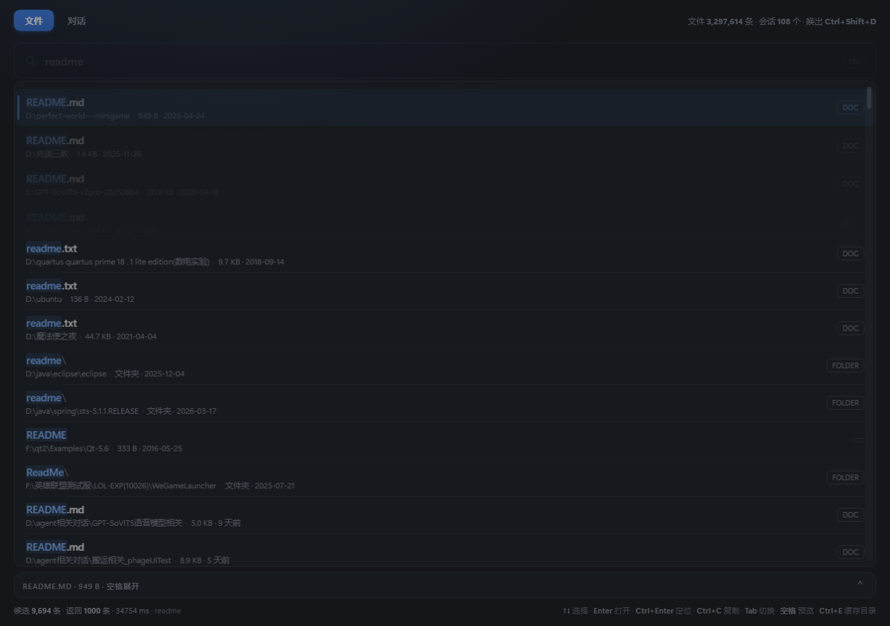
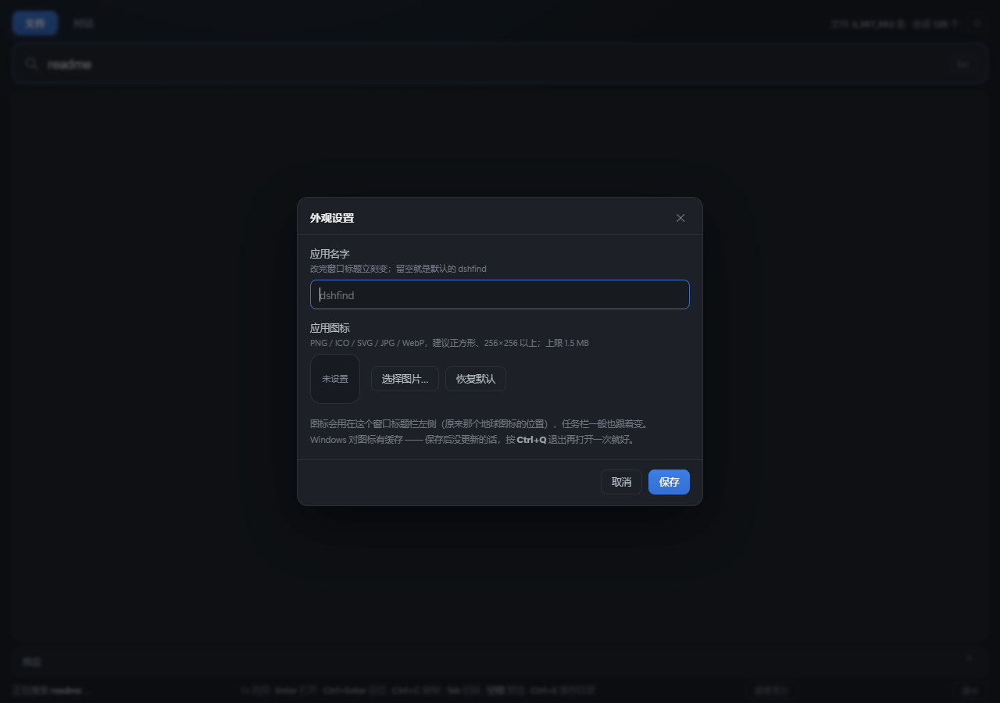
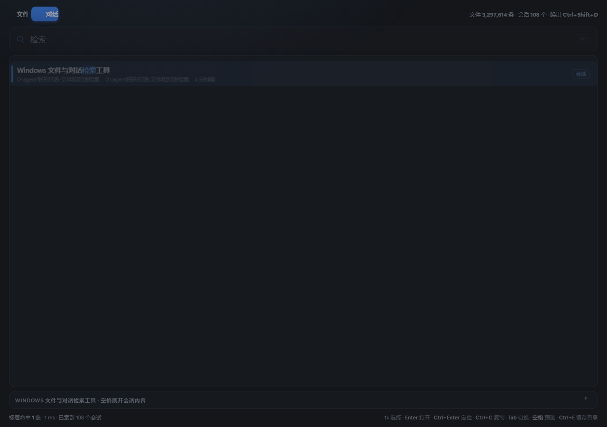

# dshfind —— Windows 上的文件与会话检索小工具

仿照 **[oil-oil/oil-find](https://github.com/oil-oil/oil-find)**（作者 **oil-oil / Lin Zhihuang**，
macOS 上的 Everything 类工具，**MIT 许可**）做的 Windows 版本，另外加了一件 oil-find 没有的事：
**能翻 DSH 的对话记录**。

> 出处与许可见文末的 [参考仓库与致谢](#参考仓库与致谢)，每一项都写了作者、许可和使用方式；
> 更细的版本号、文件清单在 [ATTRIBUTION.md](ATTRIBUTION.md)。

- 文件名常驻内存，边输入边出结果
- 拼音首字母 / 全拼检索中文（`wd` → 文档，`wendang` → 文档）
- **索引自动跟着磁盘变化**：程序开着时新建 / 删除 / 改名约 0.5 秒进索引；**新开的对话**
  最多 30 秒自动出现在「对话」模式里
- 全局热键唤起（默认 `Ctrl+Shift+D`，被占用时自动换一个能用的，实际生效的键显示在右上角）
- oil-find 那套查询语法（`ext:` `kind:` `size:` `dm:` `regex:` `|` `!` `*`）
- 「对话」模式**只搜会话标题**，不搜正文；需要看内容时再按需解压那一条
- **外观可改**：右上角 ⚙ 里换应用名字和图标（图标会裁方并生成 7 档尺寸的 ICO）
- 底部三个按钮：**重建索引**（只在"程序关着时新增的文件"才需要）、**退出**、以及右上角的设置
- 同一时间只允许一个实例；`Ctrl+Q` 干净退出（关窗口 + 落盘 + 退进程）

**界面是网页**（本地服务 + Edge 应用模式窗口），所以文字按系统缩放原生渲染、清晰不糊，
动效用的是 [GSAP](https://gsap.com/)。检索内核仍然是纯 Python、**不装任何第三方包**
（GSAP 已本地化到 `web/vendor/gsap.min.js`，运行时不联网）。

> 只想赶快用起来？看 [`使用说明.md`](使用说明.md)（三步上手 + 键盘速查 + 常见问题）。
> 想知道每一项改动为什么这么改？看 [`修改记录.md`](修改记录.md)。



---

## 快速开始

### 1. 建索引

第一次要全盘扫一遍：

```bat
python dshfind.py --reindex
```

建完之后会存到 `data/fileindex.jsonl.gz`，以后启动是秒级加载。
想改索引范围就编辑 `data/settings.json` 里的 `roots`（默认 C、D、E、F）。

> 之后就不必再手动重建了：程序启动后会用 `ReadDirectoryChangesW` 监听各卷，
> 新建/删除/改名都会增量更新索引。

### 2. 启动界面

**最方便**：双击桌面上的 **dshfind** 图标（第一次用先双击一次 `创建桌面快捷方式.bat`）。
桌面图标点一下的行为：

- 程序**没在跑** → 正常启动（开窗口）
- 程序**已经在跑** → 把已有窗口叫到前台（等同按热键），**不会**再开第二份

也可以双击 `启动 dshfind.bat`，或者：

```bat
python dshfind.py            :: 网页界面
python dshfind.py --show     :: 同上；已经在跑就把窗口叫到前台（桌面快捷方式用的就是它）
```

启动后会开一个 **Edge 应用模式窗口**（没有地址栏、没有标签页，看起来就是个独立应用）。
进程留在后台，关掉窗口后按热键还能唤出来。

> **关窗口 ≠ 退出。** 想彻底关掉后台进程，有四个办法（效果一样：关窗口 + 增量落盘 + 退进程）：
>
> 1. 窗口里按 `Ctrl+Q`，或点底部右侧的「退出」按钮；
> 2. 双击 `退出 dshfind.bat`；
> 3. 命令行 `python dshfind.py --quit`；
> 4. 上面都不行（进程卡死）：任务管理器 → 详细信息 → 结束 `pythonw3.13.exe`。

### 3. 用

| 操作 | 键 |
|---|---|
| 唤起窗口 | 全局热键 `Ctrl+Shift+D`（被别的软件占用时会自动换一个能用的，**实际生效的键显示在窗口右上角**） |
| 打开选中项 | `Enter` |
| 在资源管理器里定位 | `Ctrl+Enter` |
| 复制路径 | `Ctrl+C` |
| 上下选择 | `↑` / `↓` 或 `Ctrl+P` / `Ctrl+N` |
| 翻页 | `PageUp` / `PageDown`、滚轮、右侧滑块 |
| 展开/收起预览 | `空格` 或点预览栏右侧箭头 |
| 切换「文件 / 对话」 | `Tab` |
| 强制重建索引（把程序关着时新增的文件补进来） | `Ctrl+R`，或点底部右侧「重建索引」按钮 |
| 切换是否隐藏缓存/依赖目录 | `Ctrl+E` |
| **改名字 / 换图标** | 点右上角 **⚙**（外观设置） |
| 关闭窗口 | `Esc`（搜索框有内容时先清空，再按才是关窗） |
| **彻底退出**（连后台进程一起） | `Ctrl+Q`，或点底部右侧「退出」按钮 |

结果列表是**全高的**，放不下时用右侧那条滑块上下拉。
默认最多返回 1000 条（`/api/search` 的 `limit` 上限 5000），底部会写「返回 N / 候选 M」。

输入框是**边打边出结果**的（约 55ms 防抖，上一轮请求会被取消），不需要按回车。
索引本身也会自动更新：状态栏显示「自动更新中（已同步 N 次变更）」就说明监听在工作。

**什么时候需要点「重建索引」**：只有**程序关着的时候**新增/移动的文件才要重扫一遍
（约 8 分钟；重建期间索引不完整，可能搜不到东西）。程序开着时新增的文件、新建的对话
都会自动进来（文件约 0.5 秒，对话最多 30 秒），不用你操作。

### 4. 改名字和图标

点右上角的 **⚙** 打开「外观设置」：

- **应用名字**：输入后点保存，窗口标题**立刻**变（Edge 的 `--app` 窗口标题跟着 `document.title` 走），
  存进 `data/settings.json` 的 `app_title`，留空就是默认的 `dshfind`，最多 40 字。
- **应用图标**：选一张 PNG / ICO / SVG / JPG / WebP。页面会先把图**居中裁成正方形**，
  再缩成 16/24/32/48/64/128/256 七个档位交给服务端打成一个 **多尺寸 ICO**
  （`data/appicon.ico`，另存 256 的 `data/appicon.png` 供预览），
  通过 `/favicon.ico` 提供给窗口 —— 标题栏/任务栏会按自己的 DPI 挑最合适的那一档。
  Windows 对图标有缓存，没更新就 `Ctrl+Q` 退出再开一次。
  > 标题栏只有 16～24 像素，细节多的照片在那个尺寸下本来就看不清；构图简单、对比强的图更耐看。



同一张图在各档尺寸下的实际样子（上排原始像素、下排放大 6 倍）——16px 就是标题栏的量级：


### 5. 可调的地方

`data/settings.json`：

| 字段 | 默认 | 说明 |
|---|---|---|
| `roots` | `["C:\\","D:\\","E:\\","F:\\"]` | 索引哪些卷/目录。内存吃紧就只留关心的 |
| `hotkey` | `ctrl+shift+d` | 全局热键，格式如 `ctrl+alt+s`、`shift+ctrl+space`、`f9`。被占用时会自动换一个能用的并写回这里 |
| `per_root_budget` | 600 | 单个卷最多扫多少秒，超时就跳过剩余部分 |
| `max_entries` | 4000000 | 条目上限，防止把内存吃满 |
| `exclude_noise` | true | 是否隐藏缓存/临时/依赖目录（`node_modules`、`cache`、`temp`、WinSxS…）。界面里 `Ctrl+E` 可临时切换 |
| `index_sessions` | true | 是否在启动时顺带刷新会话标题 |
| `session_roots` | `["~/.dsh/sessions"]` | 去哪找 DSH 会话日志 |
| `app_title` | `""` | 应用名字（窗口标题）。界面右上角 ⚙ 里改，留空就是 `dshfind` |
| `app_icon_ext` | `""` | 自定义图标的扩展名；图标文件本身在 `data/appicon.<ext>` |
| `auto_rescan_on_overflow` | **false** | 监听丢事件（缓冲区溢出）时要不要**自动**全量重扫。默认不扫，只在状态栏提示、把「重建索引」按钮点亮，由你自己决定 |

### 关于噪音过滤

全盘索引里约 **一半** 的条目落在缓存、临时、依赖、系统组件这类目录里
（实测 `node_modules` 21.7 万个文件、`WinSxS` 11.4 万个文件）。
默认把它们隐藏，否则搜什么都会被它们淹没。

但如果你确实要在这些目录里找东西（比如翻某个 npm 包的源码），
按 `Ctrl+E` 切一下，状态栏会显示当前是「已隐藏」还是「含」。设置会记住。

---

## 查询语法

和 oil-find 一致：**空格 = 同时包含**，**`|` = 或者（优先级比空格高）**，**`!` = 排除**。
没有括号。

| 写法 | 含义 |
|---|---|
| `报告 2026` | 名字里同时有「报告」和「2026」 |
| `报告 \| 总结` | 有「报告」**或**「总结」 |
| `readme !node_modules` | 有 readme，且不在 node_modules 目录（含它的任何祖先） |
| `*.png` | 通配符，**锚定整个文件名**（不是子串） |
| `wd` / `wendang` | 拼音首字母 / 全拼 |
| `ext:pdf;docx` | 扩展名在集合里（分号分隔） |
| `kind:image` | 类型：`folder` `app` `doc` `image` `video` `audio` `code` `archive` `appdata` |
| `size:>10mb` | 大小，十进制单位。也支持 `size:<1kb`、`size:1mb..5mb`、`size:1048576`（裸数字=精确） |
| `dm:today` | 修改时间。支持 `today` `yesterday` `week` `month` `year`、`7d`、`2026-10-01`、`>2026-01-01`、`2026-01..2026-02` |
| `regex:^IMG_\d+` | 正则（忽略大小写，也会试拼音键） |
| `path:unity` | 只看路径里含这个子串的 |
| `file:abc` / `folder:abc` | 只看文件 / 只看目录，名字仍要匹配 abc |
| `D:\某个目录` | 直接贴路径，优先出它自己及其子项 |

「对话」模式**只搜会话标题**（按需求不搜正文）：

- 输入框里打几个字，就在所有会话的标题里做子串匹配
- 命中按「标题完全相同 > 标题以它开头 > 包含」排序，同档按最近活跃时间排
- 想看某条会话的内容，选中后按 `空格` 展开预览 —— 这时才会解压那一条的正文

---

## 架构

```
dshfind.py     数据层：拼音表、查询解析、五类索引、会话索引、命令行、自检
server.py      本地 HTTP 服务（JSON 接口）+ Edge 应用模式窗口 + 全局热键
web/           网页界面
  index.html     结构
  style.css      样式（深色、自定义滚动条、预览抽屉）
  app.js         交互逻辑 + GSAP 动效
  vendor/gsap.min.js   GSAP 3.13（本地化，运行时不联网）
bridge.js      zstd 解码桥：把 DSH 会话日志解成扁平 JSONL
pinyindata.pyz 拼音表（zip 里一个 pinyin.tsv，2.6 万字）
data/          索引与数据库（自动生成，可以整体删掉重建）
```

### 界面为什么换成网页

原来用 tkinter，有两个绕不过去的问题：

1. **文字模糊。** 进程没有声明 DPI 感知，Windows 就按 96 DPI 渲染整个窗口，
   再位图拉伸到实际缩放（这台机器 2560×1600 / 150%），字必然糊。
2. **GSAP 用不上。** GSAP 是网页动画库，tkinter 里没有 JS 运行时。

所以现在是「Python 做检索，网页做界面」：
`server.py` 只监听 `127.0.0.1`，暴露一组 JSON 接口；`web/` 是纯静态页面，
用 Edge 的 `--app` 模式显示（无地址栏、无标签页），配独立 `user-data-dir`，
不碰你日常的 Edge 配置。浏览器原生按 150% 缩放渲染，字号锐利。

接口都用一次性 token 保护（启动时随机生成、放在 URL 里），本机其他程序拿不到 token 就调不动。

### 动效（GSAP）用在哪

- 窗口/面板入场：`gsap.from` + `immediateRender:false`（这点很关键，见下面「踩过的坑」）
- 结果逐行错落淡入：只给首屏前 14 行做 `stagger`，上千行全动画会掉帧
- 滚轮平滑滚动：自己做缓动，避免一格一格跳
- 模式切换：底块用 `power3.out` 滑到当前按钮
- 索引就绪时搜索框有一次高亮脉冲

`prefers-reduced-motion` 生效时自动关掉全部动效。

### 文件索引

扫描用 `os.scandir`，跳过重解析点（软链接/挂载点），目录噪音名（`node_modules`、`.git`、
`WinSxS`…）命中后整棵子树打 `noise` 标记，检索时默认过滤。

名字以小写 `str` 常驻内存，**匹配靠 `str.find` / `in`**，也就是 CPython 里高度优化的
C 实现。这跟 oil-find 用 C + NEON 做批量字符比对的思路一致，只是把活交给了解释器的 C 层。

索引持久化用「列式二进制」：一份把所有路径用 `\n` 拼起来的大字符串 + 若干条扁平 int 列
（起点、终点、是否目录、大小、mtime、深度），整体 marshal + gzip。
这样存的时候不用逐条建结构、读的时候一次反序列化就能拿到所有列。
条目本身是 `BlobEntry`，只存 `(起点, 终点)` 两个整数，路径和小写形式都是**切片视图** ——
316 万条目要是每条都存三个字符串，光造对象就要十几秒、多占几百 MB。

打分是 oil-find 那套加性整数：匹配质量分四级（全名精确/前缀/词边界/内部子串），
名字越长扣越多，噪音目录、Windows 目录、Temp 目录额外惩罚。

单次查询是「先用索引筛出候选，再打分取前 N」。有五种索引可用：

| 索引 | 服务什么 | 代价 |
|---|---|---|
| 拼音索引（内存） | `wd` / `wendang` / 中文 | 预建 2–3 秒 |
| 名字 trigram 索引（SQLite FTS5） | 3 字以上的英文子串 | 440 MB，建一次 86 秒 |
| 扩展名索引（内存） | `ext:` / `kind:` / `*.png` | 加载时预建 2.5 秒 |
| 排序索引（按大小、按时间） | `size:` / `dm:` | 56 MB，建一次 15 秒 |
| 结果缓存 | 同一查询重复执行 | 48 条 LRU |

多个条件时取**候选集最小**的那个当起点，其余条件在一小撮上验一遍。

几个关键的加速点：

- **拼音索引**：全部条目里只有不到 1% 含汉字，预建一次之后 `wd` 是字典命中、0 毫秒。
  不预建的话，"每次查询给所有 ASCII 名字算一遍拼音"会是几十秒的活。
- **名字 trigram 索引**：`readme` 之前要在 Python 里逐个比对 343 万条（4.2 秒），
  现在交给 SQLite 的 C 层筛出 9833 条候选（40 毫秒）。
- **排序索引**：`size:>100mb` 之前要全扫（5.2 秒），现在是一次 `bisect` 二分（1 毫秒）。
  实现方式是两份按值排好序的条目下标数组（`array('i')`，共 56 MB）。
- **纯过滤查询不排序**：`size:`/`dm:`/`kind:` 这类没有名字关键词的查询，
  所有候选分数完全相同，直接按索引顺序取前 N，省掉对几十万条排序。

### 索引怎么自动跟着磁盘变

全盘重扫一次要八分钟，所以不能靠"定期重扫"来保持新鲜。程序启动后会用
`ReadDirectoryChangesW` 对每个卷做递归监听（4 个卷 = 4 个句柄），
收到变更后只更新受影响的那几条：

| 情况 | 处理 |
|---|---|
| 新建文件/目录 | 加进内存里的增量列表（overlay），同时补进名字索引、扩展名索引、拼音索引 |
| 文件中被改写 | 原地更新大小和修改时间 |
| 删除或改名 | 打上"已删除"标记，查询时跳过 |

增量会落盘到 `data/delta.json`（通常几十 KB），**重启后接着用**，
所以新建的文件不会在重启后消失。

极端情况：短时间内变更太密集导致系统缓冲区溢出、事件丢了 —— 这时安排一次全量重扫兜底
（限 15 分钟最多一次，免得反复扫盘）。

### DSH 会话索引

「对话」模式**只索引标题**（按你的要求不搜正文），所以索引阶段根本不碰日志文件：

| 项目 | 来源 |
|---|---|
| 标题 | `~/.dsh/storages/session_projcache` 里的投影缓存 |
| 项目 / 时间 / 工作目录 | 同一份缓存 |

**什么时候自动更新**（三处）：

1. 启动时刷一次；
2. **之后每 30 秒自动刷新一次**（`DSHFIND_SESSION_REFRESH` 环境变量可改间隔，设 0 关闭）；
3. 按 `Ctrl+R` 全量重建时。

`index_sessions` 只读标题，124 个会话约 0.2 秒，所以可以刷得这么勤。
新建的对话通常 **30 秒内**就能在「对话」模式里搜到；要是 DSH 还没给它生成标题，
会先按「无标题」列出，标题生成后下一次刷新就补上。

正文只在**预览**时才读：点开某条会话，`bridge.js` 才去解压那一条。
`session.v3.jsonl.zstd` 是拼接的**多帧 zstd**（每个 append 批次一个独立帧、各自带校验和），
不是单个连续流，Python 的 zstd 一次解不完 —— `scanZstdFrames` 逐帧扫。
预览里按角色设了长度上限（`tool-result` 只留头 2600 字 + 尾 1400 字），免得一份 dump 撑爆内存。

**只读 `~/.dsh`**，不写它的任何东西；自己的库在 `data/dshfind.db`。

---

## 实测数据（本机，Windows 11 / Python 3.13）

### 索引规模

> 条目数每次重建会浮动（F 盘会撞扫描预算被截断），本机几次重建在 **318 万～343 万**之间。
> 下面主表取自一次 343 万条的重建；**最近一次（2026-10-27）是 339 万条
> （294.2 万文件 + 45.2 万目录）**，文件索引 58.9 MB、名字索引 417 MB。

| 项目 | 数据 |
|---|---|
| 全盘扫描范围 | C、D、E、F 四个卷 |
| 扫到的条目 | **343 万**（294 万文件 + 48.6 万目录） |
| 文件索引 | 59.6 MB（gzip 列式二进制） |
| 名字索引 | 440 MB（SQLite FTS5 trigram） |
| 排序索引 | 56 MB（按大小、按时间的两份下标数组） |
| 会话库 | 0.15 MB（只存标题） |
| 扫描耗时 | 约 8 分钟（C 盘目录特别多，F 盘撞上扫描预算被截断） |
| 建名字索引 | 约 86 秒 |
| 排序索引 | 建一次 15 秒，之后读缓存 0.7 秒 |
| 常驻内存 | 约 2.7 GB |

### 启动

| 阶段 | 耗时 |
|---|---|
| 窗口出现 | **约 1 秒**（索引在后台异步载入，窗口先出来） |
| 索引可用 | **约 20～25 秒**（339 万条目建对象 + 拼音索引；启动**不会**自动重扫磁盘） |

### 查询

| 查询 | 耗时 | 命中候选 | 走的是 |
|---|---|---|---|
| `wd` | **0 ms** | 1 | 拼音索引 |
| `文档` | **2 ms** | 43 | 拼音索引 |
| `size:>100mb` | **1 ms** | 1,611 | 排序索引二分 |
| `size:>1gb` | **0.3 ms** | 272 | 排序索引二分 |
| `*.png` | **3 ms** | 177,088 | 通配符 → 扩展名索引 |
| `*.md` | **0.7 ms** | 38,685 | 同上 |
| `dm:week` | **26 ms** | 89,873 | 排序索引二分 |
| `report \| 报告` | **33 ms** | 1,874 | 两个分支各走索引再合并 |
| `readme` | **55 ms** | 9,833 | 名字 trigram 索引 |
| `readme ext:md` | 53 ms | 7,334 | 名字索引 ∩ 扩展名索引 |
| `python ext:py` | 62 ms | 236 | 同上 |
| `settings` | 75 ms | 23,603 | 名字 trigram 索引 |
| `unity` | 250 ms | 70,336 | 名字 trigram 索引 |
| `size:<1kb` | 300 ms | 846,960 | 排序索引，但要遍历 85 万条 |
| `kind:image` | 340 ms | 322,976 | 扩展名索引，但要遍历 32 万条 |
| `dm:>2026-01-01` | 300 ms | 1,035,732 | 排序索引，但要遍历 100 万条 |

到这里所有常见查询都在**几十毫秒到 300 毫秒**之间。剩下那 300 毫秒不是筛选慢，
而是"要把几十万条走一遍取前 50"本身的开销。

每个查询结果都有缓存，同一个查询第二次是瞬开的。

### 会话（只搜标题）

| 项目 | 数据 |
|---|---|
| 会话数 | 124 个（随用随涨） |
| 建索引（全部） | **0.06 秒**（只读标题，不解压正文） |
| 定时刷新 | 每 30 秒一次，约 0.2 秒（124 个会话） |
| 标题检索 | 1～2 ms |
| 预览某条会话 | 按需解压那一条，约 0.1～0.5 秒 |
| 会话库体积 | **0.14 MB**（以前把正文也存下来是 340 MB） |



上图是「对话」模式：左边是标题命中的会话，右边预览是**按需**解压出来的那一小段，
没点开之前一条日志都不解压。

### 界面侧（网页）

| 项目 | 数据 |
|---|---|
| 窗口出现 | 不到 1 秒（索引后台载入，页面先渲染） |
| 首次搜索结果 | 冷缓存 0.3～0.9 秒；命中缓存 17～73 毫秒（1000 条） |
| 每行要还原真实大小写 | 按目录 `scandir` 并缓存结果；1000 条横跨 900 多个目录，首次约 700 ms，之后为 0 次目录读取 |
| 打字时的旧查询 | 新请求会让旧查询**当场收工**（服务端每 4096 条自查一次），不排队 |
| 说明 | 这些数字是在 343 万条索引上量的 |

文件模式一次查询要几百毫秒，所以输入框下方会先出现「正在搜索 …」（旧结果压暗），
不是卡住 —— 这是第 7 项改动加的即时反馈。

---

## 与 oil-find 的对照

| 方面 | oil-find | 这里 |
|---|---|---|
| 名字存储 | 二进制列式数组 + 连续字节 arena | Python 对象 + 小写 str（本机数据量下够快） |
| 匹配 | C 实现，ARM NEON 向量化 | CPython `str.find`（C 层，无 SIMD） |
| 拼音 | 运行时用 macOS ICU 生成 2 万字表 | 固化的等价数据表（Windows 没有对应 API） |
| 增量监听 | FSEvents 游标续接 | 周期性全量重扫比对（Windows 的 ReadDirectoryChangesW 有溢出丢事件问题；全盘扫只要几十秒） |
| 结果收敛 | 有单调性证明的增量窄化 | 每次全扫，不做窄化 |
| 查询语法 | `ext:` `kind:` `size:` `dm:` `regex:` `\|` `!` `*` | 同左，另加 `path:` |
| 全局热键 | Carbon `RegisterEventHotKey` | `RegisterHotKey`（等价物，系统级吃掉按键，无需额外权限） |
| 平台 | 仅 macOS（Apple 芯片） | 仅 Windows |

有意思的是，oil-find 自己**完全没有 Windows 实现**：仓库里 `#if os(...)` 一个都没有，
CI 只有 `macos-14` 一个 job，所有 "Windows" 提及都是在拿 Everything 做市场定位。

原版研究笔记见仓库外的 scratch 目录（那次调研把源码完整取下来读过）。

---

## 已知限制

- **只支持 Windows**。依赖 `RegisterHotKey`、`st_file_attributes`、`explorer /select`、
  Edge（应用模式窗口）。没有 Edge 时会退回用默认浏览器打开同一个地址。
- **同一时间只允许一个实例**：靠命名互斥体判断，第二个实例会打印
  「已经有一个 dshfind 在跑了」并直接退出（多开不会多点功能，只会多占一份 2.7 GB 内存，
  还会把热键配置搅乱）。想换端口调试可以用 `python _qa_serve.py 8792`。
- **热键可能注册失败**：`RegisterHotKey` 是"系统级吃掉这个组合键"，只要已有别的程序
  占着同一个组合（错误码 1409），就注册不上。程序会自动依次尝试
  `ctrl+shift+g`、`ctrl+alt+f`、`ctrl+shift+d` 等备选，把第一个能用的写进
  `data/settings.json`，实际生效的键显示在窗口右上角。
  **注册和轮询必须在同一个线程**里（`serve()` 的 `run_hotkey`）——`RegisterHotKey(None, …)`
  是登记给调用它的那个线程的，换个线程 `PeekMessage` 就永远收不到（第 8 项踩过）。
- **通配符 / 大小 / 时间查询仍偏慢**：`*.png`、`size:>`、`dm:` 没有索引可用，
  要全扫 343 万条（1～8 秒）。搭配名字关键词会快很多（`png ext:png` 是 340 ms）。
- **索引自动更新有 1～3 秒延迟**：靠 `ReadDirectoryChangesW` 监听，新建/删除/改名会在
  1～3 秒内反映到结果里（实测：新建 0.5 秒、改名 0.6 秒、删除 0.6 秒）。
  例外：监听缓冲区溢出（丢了事件）时，**默认不会自动重扫**，只在状态栏提示
  「监听丢过事件，索引可能不完整」并把「重建索引」按钮点亮 —— 扫不扫由你决定
  （想让程序自动扫就把 `auto_rescan_on_overflow` 设成 `true`，那是每次 8 分钟的磁盘活动）。
- **程序没在运行时新增的文件，不会自动出现**：监听只在运行时有效，也没有"按时间戳补扫"
  （`age_seconds()` 那个方法目前是空的，早先文档里写的"超过 7 天自动重扫"其实没实现）。
  想让它们出现，按 `Ctrl+R` 重建一次（全盘约 8 分钟），或者重跑 `python dshfind.py --reindex`。
- **内存占用约 2.7 GB**：343 万条目 + 路径大字符串。已加 400 万条目上限
  （`data/settings.json` 里的 `max_entries`）避免把机器拖垮。
  内存吃紧的话，把 `roots` 改成只关心的一两个目录。
- **F 盘撞了扫描预算**：240 秒没扫完就停下，会打印「超时预算」并跳过剩余部分。
  改 `data/settings.json` 的 `per_root_budget` 可以放宽。
- **「对话」只搜标题**（按需求）。正文需要预览某条会话时才会解压，
  所以搜"对话里说过什么"是搜不到的 —— 这是有意的。
- **新对话大约 30 秒后能搜到**：会话没有文件那种变更通知，只能定时扫（见上一节）。
  要是刚开的新对话搜不到，等一下再试；标题还没生成时会先显示「无标题」。
- **会话标题来自 DSH 的投影缓存**：`~/.dsh/storages/session_projcache`。
  如果某个会话还没有生成标题（DSH 没来得及生成），它就只能按「无标题」显示。
- **拼音只覆盖 U+3400–U+9FFF**（CJK 基本区 + 扩展 A）。多音字只取第一个读音。
- **文件名索引不含目录名**：`readme` 只匹配文件名，不会因为某个目录叫 `readme` 就
  把里面的文件都列出来。要按目录名找请用 `path:readme`（那条是全扫，会慢一点）。
- **最多返回 1000 条**（可调到 5000）。结果全在列表里，滚动查看；底部写明
  「返回 N / 候选 M」，不会假装全都在。
- 拖拽到其他程序打开没有实现。
- 索引里存的是小写路径（为了省内存），显示时再按目录 `scandir` 还原真实大小写
  （`GetLongPathNameW` 不保证逐段还原大小写，实测不可靠）。已删除的路径会显示为小写。

## 调试用命令

```bat
python dshfind.py --selftest              :: 全套自检，不弹窗（含"真按一次热键"、索引一致性、噪音覆盖）
python dshfind.py --text "查询内容"        :: 终端里跑一次查询（文件和会话都查）
python dshfind.py --reindex               :: 强制重建全部索引（文件 + 排序 + 名字）
python dshfind.py --fts                   :: 只重建名字索引（不重新扫盘，约 86 秒）
python dshfind.py --sessions --rebuild    :: 强制重建会话索引
python server.py --no-window --port 8790  :: 只起服务，用浏览器调试前端
python _test_server.py                    :: 接口冒烟测试（21 项）
python _test_watch.py                     :: 监听端到端（真的新建/删除/改名，等它自己出现）
python _acceptance.py                     :: 按目标逐条验收
python _qa_serve.py 8792                  :: 起一个不注册热键的调试服务，打印带 token 的地址
node _qa_typing.mjs "http://127.0.0.1:8792/?t=qatoken123"
                                          :: 无头 Chrome 逐字敲键，量"打字→出结果"的真实时间
python _test_hotkey_e2e.py                :: 合成按一次热键，验证 focus() 被调用
python _test_hotkey_realwin.py            :: 真开窗口 → 最小化 → 按热键 → 看窗口回不回来
python _test_quit.py                      :: 带窗口起一个实例 → --quit → 确认进程和窗口都没了
python _test_auto.py                      :: 建/改名/删文件测"多久能搜到"，顺带数会话刷新次数
python _test_appearance.py                :: 外观接口测试（改名、上传/恢复图标、格式校验）
python _test_ico.py                       :: 多尺寸 ICO 打包的单测（目录/偏移/PNG 头部）
node _test_icon_ui.mjs "http://127.0.0.1:8792/?t=qatoken123" "D:\path\to\icon.png"
                                          :: 真的选一张图 → 裁方 + 七档缩图 → 检查生成的 ICO
node _test_appearance_ui.mjs "http://127.0.0.1:8792/?t=qatoken123"
                                          :: 无头 Chrome 真点一次齿轮，确认改名字后标题真的变
node _test_reindex_btn.mjs "http://127.0.0.1:8792/?t=qatoken123"
                                          :: 真点一下「重建索引」按钮，确认后端开始重建
python dshfind.py --quit                  :: 让正在跑的那个实例干净退出
python dshfind.py --show                  :: 没跑就启动、在跑就把窗口叫到前台（桌面快捷方式用）
```

## 自检覆盖了什么

`--selftest` 会实际验证下面这些，任何一项不达标都会返回非零退出码：

| 检查 | 说明 |
|---|---|
| 拼音表 | 已加载、`文档` → `wd` / `wendang` |
| 查询解析 | `\|` 的 OR 分支、`ext:`、`!`、`size:`、`dm:`、盘符不被误当过滤器 |
| 索引可加载 | 条目数 |
| 能搜到 `readme` | 端到端搜索可用 |
| 索引路径为小写 | 防"小写关键词漏掉大写文件名" |
| 噪音覆盖整棵子树 | `winsxs` / `node_modules` 下**全部**文件都标记（不是抽样） |
| 大小写不敏感 | `license` 与 `LICENSE` 候选数一致 |
| 名字索引同源 | FTS 库与文件索引对得上，且能查询 |
| 排序索引 + 二分 | `size:>100mb` 必须走二分（< 200ms） |
| 全局热键 | **真的合成按一次**这个组合键，并在 1.5 秒内收到 `WM_HOTKEY`（只"注册成功"不算数） |
| 会话库 | 可读、可检索 |

## 文件布局

```
dshfind.py          数据层：拼音表、查询解析、五类索引、会话索引、命令行、自检
server.py           本地 HTTP 服务 + Edge 应用模式窗口 + 全局热键
web/                网页界面（index.html / style.css / app.js + GSAP）
bridge.js           DSH 会话日志的 zstd 多帧解码桥（Node）
pinyindata.pyz      拼音表（zip 内一个 pinyin.tsv，2.67 万字）
启动 dshfind.bat         双击启动（网页界面）
创建桌面快捷方式.bat     在桌面建一个 dshfind 图标（点一下启动 / 叫到前台）
退出 dshfind.bat         双击彻底退出（关窗口 + 落盘 + 退进程）
_build_pinyin.py    重新生成拼音表的脚本
_test_server.py     接口冒烟测试（21 项，进程内起服务）
_test_watch.py      监听端到端测试（真的新建/删除/改名）
_acceptance.py      按目标逐条验收
_qa_serve.py        调试服务（不注册热键、不开窗口，打印带 token 的地址）
_qa_typing.mjs      逐字敲键的浏览器基准（无头 Chrome + CDP，量打字到出结果）
_test_hotkey_e2e.py 热键链路验证（起 serve 后合成按键，看 focus() 有没有被调用）
_test_hotkey_realwin.py  真开一次窗口、最小化、按热键，看窗口会不会回来
_test_quit.py       退出端到端验证（带窗口起实例 → --quit → 进程和窗口都没了）
_test_quit_fallback.py   验证"找不到实例信息时按进程名硬杀"的兜底
_test_auto.py       自动收录验证（真建/改名/删文件看多久能搜到；数会话刷新次数）
_test_appearance.py 外观接口测试（改名 / 上传图标 / 格式校验 / 恢复默认）
_test_appearance_ui.mjs  无头 Chrome 真点齿轮，验证"改名字→窗口标题真的变"
_test_ico.py        多尺寸 ICO 打包单测
_test_icon_ui.mjs   真的选一张图跑完整图标流程，检查生成的 ICO 各档
_test_reindex_btn.mjs    无头 Chrome 真点一下底部「重建索引」，确认后端真的开始重建
data/
  settings.json       可调配置（含 app_title / auto_rescan_on_overflow 等）
  instance.json       正在跑的实例（pid/端口/token），`--quit` 靠它找进程
  appicon.ico         自定义图标（多尺寸，16/24/32/48/64/128/256）
  appicon.png         图标的 256 档，面板预览用
  fileindex.jsonl.gz  文件索引（列式二进制 + gzip，59 MB）
  nameindex.db        名字 FTS5 trigram 索引（417 MB）
  sortindex/          按大小/时间排序的下标数组（17 MB）
  dshfind.db          会话标题库（0.15 MB）
  delta.json          监听产生的增量（新增/删除），重启后接着用
  edgeprofile/        Edge 应用窗口的独立配置（删掉无妨，会重建）
使用说明.md         给用户看的：三步上手 + 键盘速查 + 常见问题
修改记录.md         每次改动的问题 → 排查 → 改法 → 验证
项目备忘.md         现状、坑、未解决问题（开工前先读这一份）
ATTRIBUTION.md      第三方资源出处（作者 / 许可 / 用在哪）
LICENSE             本项目 MIT 许可
screenshot*.png     界面 / 外观设置 / 图标各档尺寸的截图
```

`.gitignore` 已经把 `data/`、`__pycache__/`、`_aclfix/`、`*.log` 排除掉了 ——
索引和会话库是本机数据，不入库。

---

## 参考仓库与致谢

本工具是原创代码（Python），**没有复制**下面任何项目的源代码；但设计思路、拼音数据、
日志格式和动效库来自这些作品。按各自许可的要求，作者与出处列在这里；
更细的说明（版本号、到底借鉴了哪几处、文件清单）见 [ATTRIBUTION.md](ATTRIBUTION.md)。

| 项目 | 作者 / 组织 | 许可 | 本项目怎么用的 |
|---|---|---|---|
| [oil-oil/oil-find](https://github.com/oil-oil/oil-find) | **oil-oil（Lin Zhihuang）** | [MIT](https://github.com/oil-oil/oil-find/blob/main/LICENSE) | **整体设计参照**：文件名常驻内存实时收敛、扁平两级查询语法（空格 AND / `\|` OR / `!` NOT）、`ext:` `kind:` `size:` `dm:` 那套过滤器、加性整数打分、目录噪音继承、拼音双键。源码是 Swift + C，这里是 Python，**未复制代码**，只借鉴设计 |
| [mozillazg/python-pinyin](https://github.com/mozillazg/python-pinyin) | **mozillazg**（含 闲耘 / hotoo） | [MIT](https://github.com/mozillazg/python-pinyin/blob/master/LICENSE.txt) | **拼音数据**：`pinyindata.pyz` 里的「汉字 → 拼音」取自 pypinyin 0.55.0 的字典，取首读音去声调后重新打包；运行时**不依赖**它，也不联网 |
| [DeepSeek Harness（DSH）](https://github.com/deepseek-ai) | **DeepSeek** | 见其仓库 | **会话日志格式**：只读 `~/.dsh/sessions/**/session.v*.jsonl.zstd`；`bridge.js` 的多帧 zstd 帧扫描逻辑参考了 DSH 的 `dsh-session-persistence-jsonl` 包 |
| [GSAP](https://gsap.com/) | **GreenSock** | [Standard License](https://gsap.com/standard-license)（一般用途免费，含商用） | **界面动效**：3.13.0，本地化在 `web/vendor/gsap.min.js`，未修改，文件头保留原始版权声明；运行时不联网 |
| [SQLite FTS5](https://www.sqlite.org/fts5.html) | **SQLite 团队（D. Richard Hipp 等）** | 公有领域 | **名字索引**：`nameindex.db` 的 trigram 全文索引 |

另外用到但不需要署名的：Python 标准库（`http.server` / `sqlite3` / `marshal` / `gzip` /
`zipfile`）、Windows 系统 API（`RegisterHotKey`、`ReadDirectoryChangesW`、
`SetProcessDpiAwarenessContext`、`os.scandir`）、系统自带字体（Segoe UI / Microsoft YaHei UI /
Consolas）。界面里没有网络字体、没有 CDN、没有第三方 Python 依赖。

## 许可

本项目代码采用 **MIT 许可**，版权归仓库所有者（见 [LICENSE](LICENSE)）。

再分发时请同时保留：本项目 LICENSE、上面表格里各项目的许可声明，以及
`web/vendor/gsap.min.js` 文件头里的 GreenSock 版权声明。
